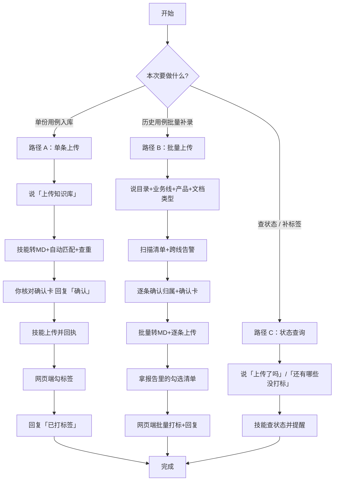

# xmind 测试用例 → weknora 归档｜测试人员操作流程（v2.4）

> 面向：效贷 / 效融 / 小贷 / 泾渭云 / 智慧记零售 / AI进销存 六条业务线测试人员
> 目标：把测试专家产出的 **xmind 用例终稿** 转成 Markdown 并归档到团队 weknora 知识库
> 核心承诺：**你唯一需要配的是 MCP 连接器（url + Authorization），其余全部自动匹配**

---

## 一、先记住三句话

| # | 说法 | 说明 |
| --- | --- | --- |
| 1 | **配一次，长期复用** | 首次在 AI 工具里连上你业务线的 weknora 空间（MCP），之后不用再配 |
| 2 | **不用管传到哪个库** | 空间 / 知识库 / 业务线 / 专家归属全部内置在 skill 里，自动匹配 |
| 3 | **上传前必须你点头** | 每次上传前都会给你一张 8 项确认卡，你回复「确认」后才真正上传；**沉默不算确认** |

---

## 二、首次使用：一次性准备（约 5 分钟）

### ✅ 要做：第 1 步 配 MCP 连接器

按你的业务线，找管理员要对应空间的 **url** 和 **令牌**：

| 你的业务线 | 需要连接的空间 | weknora 空间ID |
| --- | --- | --- |
| 效贷、效融 | 场景业务线 | 10004 |
| 泾渭云、小贷 | 数据业务线 | 10003 |
| 智慧记零售（AI零售）、AI进销存（星火） | 智慧记 | 10006 |

配置写法（WorkBuddy：`C:\Users\<用户名>\.workbuddy\mcp.json`，在 `mcpServers` 里**追加**，别覆盖已有条目）：

```json
{
  "mcpServers": {
    "weknora-changjingyewu": {
      "url": "https://finwiki.kingdee.com/mcp/<空间端点UUID>",
      "headers": { "Authorization": "Bearer mcp_<令牌>" }
    }
  }
}
```

- 起作用的只有 **`url`** 和 **`Authorization`** 两个字段；
- **服务器名随便起**（`我的效贷库` 也行）——技能按 url 识别空间，不看你起的名字；
- 配完：连接器管理页点「信任」→ **重启会话**。

### ✅ 要做：第 2 步 在你的知识库里建 4 个标准标签（一次建好，长期复用）

打开你负责的知识库 → 「标签」→ 新建，依次建这 4 个（名称逐字一致）：

```
测试用例    测试总结    测试需求分析    测试缺陷
```

> 标签是**知识库级**的，每个库各建一次。上传后技能会提醒你勾标签，那时标签必须已存在，否则选不到。

### ❌ 不用做（别被误导）

- 不需要创建/修改 `weknora_mcp.json`（没有这个文件完全正常）
- 不需要填知识库 ID、业务线映射、专家归属
- 不需要保证服务器名和别人一致
- 团队新增知识库也不用你配——告诉智能体一句「新增了 XX 库，归属 XX 线」即可

### 自检（配完后让智能体跑，或自己执行）

```
python scripts/init_config.py --discover   # 看空间是否识别到、工具前缀是什么
python scripts/init_config.py --doctor     # 一键体检
```

目标空间显示 ✅ 即连通；❌ 就是还没配好。

---

## 三、日常使用：三条路径



### 路径 A：单份用例上传（最常用，专家流程内）

**触发语**：`上传知识库` / `归档用例` / `同步 weknora` / `用例入库`
（不说话也没关系——专家产出 xmind 后智能体会主动问你「是否现在上传」。）

| 步骤 | 你做的 | 智能体做的 |
| --- | --- | --- |
| A1 | 确认手上这份是**终稿/终版**（文件名含 `终版/终稿/final`，或你口头确认） | 定位最新 xmind，非终版会提示一句 |
| A2 | —— | 转 Markdown（新旧 xmind 格式都支持），回显前 30 行给你看 |
| A3 | —— | 按业务线自动匹配 空间 + 知识库 + 专家归属，并查重 |
| A4 | **核对确认卡 8 项，回复「确认」** | 未确认不上传 |
| A5 | —— | 上传（新建 / 更新已有文档），回执给出文档 ID |
| A6 | 到 weknora 网页端给该文档勾标签 | 立即提醒你打标路径 |
| A7 | 回复「已打标签」 | 回写进度为 done |

**上传后打标操作（一步到位）**：

> weknora 知识库页（如 **效贷_测试_测试用例**，空间：场景业务线）→ 勾选刚上传的文档 → 点「标签」→ 添加标签 → 选择「**测试用例**」→ 确定

### 路径 B：批量补录历史用例

**触发语**：`把 D:\xxx 目录下的历史 xmind 批量上传到 XX 库`

| 步骤 | 你做的 | 智能体做的 |
| --- | --- | --- |
| B1 | 给出**四要素**：目录、业务线、产品、文档类型（+ 是否递归） | 不用推断值直接开工，会先跟你确认 |
| B2 | —— | 对账该空间知识库、扫描生成清单，跨线文件打 ⚠️ |
| B3 | **逐条确认跨线告警项的归属**，再过确认卡回复「确认」 | 未确认不上传 |
| B4 | —— | 批量转 MD → 逐条上传 → 逐条记录进度（中断可续传，不会重复） |
| B5 | 看报告里的「待打标勾选清单」 | 报告按标签分组，可直接照着勾 |
| B6 | 网页端**一次勾选多份**打标 → 回复「打好了 2,3」 | 回写进度 |

> 硬规则：换目录 / 换业务线 / 换文档类型，都要**重新确认一次**；单条失败不中断，最后报告汇总。

### 路径 C：查询与补漏

| 你说 | 智能体回 |
| --- | --- |
| `上传了吗` / `上传到知识库了吗` | 已上传 → 回执 + 打标状态；未上传 → 提醒并给「说『上传知识库』即可归档」 |
| `还有哪些没打标签` | 列出全部「已上传未打标」文档清单 |
| `已打标签` / `打好了` | 回写进度为 done |

---

## 四、确认卡：你每次要看清的 8 项（防传错库）

```
请确认本次上传目标（回复「确认」后我才上传）：
1. 业务线：效贷（XD）｜对应专家：效贷效融测试专家-轻量版
2. 空间：场景业务线（weknora 空间ID 10004）
3. 知识库：效贷_测试_测试用例（ID 6603ca32-0432-424e-8972-628377d4bfe0）
4. 文档类型：测试用例（weknora 标签：测试用例）
5. 文档标题：效贷_PRJ-00770309_额度申请_测试用例_20261015
6. 来源文件：D:\…\额度申请_测试用例_终版.xmind（共 1 份）
7. 上传方式：新建 / 更新已有文档（<doc_id>）
8. weknora 标签：需上传后人工勾选
```

**重点核对第 2、3 项**（空间ID + 知识库名/ID 逐字核对，不凭印象），其次第 1、4 项。

### 你的目标库速查（内置映射，供核对用）

| weknora空间ID | 空间名称 | 业务线 | 知识库名称 | 知识库ID |
| --- | --- | --- | --- | --- |
| 10004 | 场景业务线 | 效贷 | 效贷_测试_测试用例 | 6603ca32-0432-424e-8972-628377d4bfe0 |
| 10004 | 场景业务线 | 效融 | 效融_测试_测试用例 | 9c5ca48b-3c4c-442a-8b1a-bbfada555eca |
| 10004 | 场景业务线 | 效贷 | 效贷_测试_测试总结 | f49f73fa-46c1-4d5a-9c3f-41a2343ee3b5 |
| 10004 | 场景业务线 | 效融 | 效融_测试_测试总结 | e4af9e3a-6a6b-4ca6-b7c4-2cdf1cfea8c3 |
| 10003 | 数据业务线 | 泾渭云 | 泾渭云_测试_测试用例 | 4b61aa94-2478-49e2-84c9-4847b309871c |
| 10003 | 数据业务线 | 小贷 | 小贷_测试_测试用例 | dce548fd-ac44-4fdd-b2b4-deb24056605b |
| 10006 | 智慧记 | 智慧记零售（AI零售） | AI零售_测试_测试用例 | 5e13077c-225c-4777-b644-528ec4b251e0 |
| 10006 | 智慧记 | 智慧记星火（AI进销存） | AI进销存_测试_测试用例 | 97dbc25a-70d2-4ff9-8255-0f6982143fe6 |

---

## 五、四个常见分支（遇到别慌，按规则走）

| 情况 | 你会看到 | 你怎么做 |
| --- | --- | --- |
| **① 目标与预设不一致** | 「你指定的目标与团队预设映射不一致 —— 是新建了知识库，还是换了业务线？」 | 回一句：**「新增了 XX 库，归属 效贷/效融/泾渭云/小贷/智慧记零售/AI进销存」**；或说「是我记错了，应该是 XX」 |
| **② 发现未登记知识库** | 列出 N 个映射里没有的库，问你要传哪个、归属哪条线 | 同上，确认后由智能体登记（路由未命中时**不会**凭相似名称硬传） |
| **③ 批量时跨线告警 ⚠️** | 清单里标 ⚠️ 并建议「可能应传到 XX 库」 | **逐条确认归属**，不能按目录默认值直接传 |
| **④ 查重命中已有文档** | 「更新已有 / 新建一份？」 | 默认建议**更新**（避免库里堆多份版本不明的用例） |

---

## 六、标签：为什么还要你手动勾一下

| 项 | 现状 |
| --- | --- |
| 文档类型自动判定 | ✅ 会（写进标题、MD 头部、确认卡第 4 项） |
| 通过 MCP 自动打标签 | ❌ 不行（weknora MCP 的 `add_document` 无 tags 参数，已实测） |
| 通过 REST 自动打标签 | ⚠️ 服务端支持，但 MCP 令牌对 `/api/*` 返回 401，需换用户级令牌（方案 B，待启用） |

**当前方案 C**：类型由技能判定 → 标签由你在网页端勾选 → 技能全程提醒 + 记进度 + 每个步骤收尾复查，直到你回复「已打标签」。

---

## 七、速查卡（建议贴工位）

```
首次：配连接器（url+Authorization）→ 建 4 个标准标签
日常：专家出 xmind 终稿 → 说「上传知识库」→ 核对确认卡 → 回「确认」
      → 网页端勾标签 → 回「已打标签」→ 完成
批量：说「把 <目录> 的历史用例传到 <业务线> 库」→ 确认四要素 → 处理 ⚠️ 跨线项
      → 回「确认」→ 照报告清单批量打标 → 回「打好了」
查询：「上传了吗」「还有哪些没打标签」
新增库：只需说「新增了 XX 库，归属 XX 线」
```

**红线**：❌ 不传非终稿｜❌ 未回复「确认」不上传｜❌ 不确定目标库时不猜，先问｜❌ 令牌不进 Git、不发群、不贴进 skill 包。
